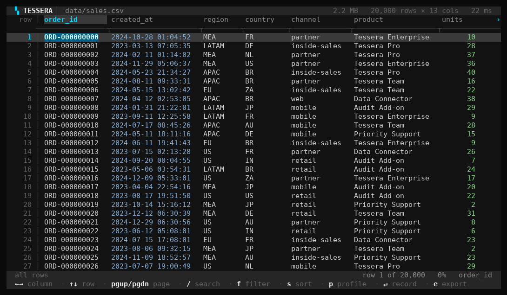
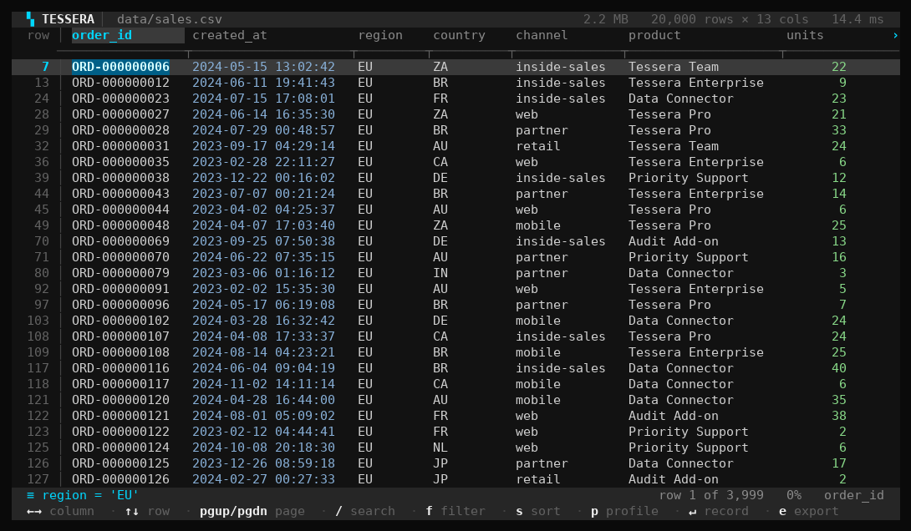
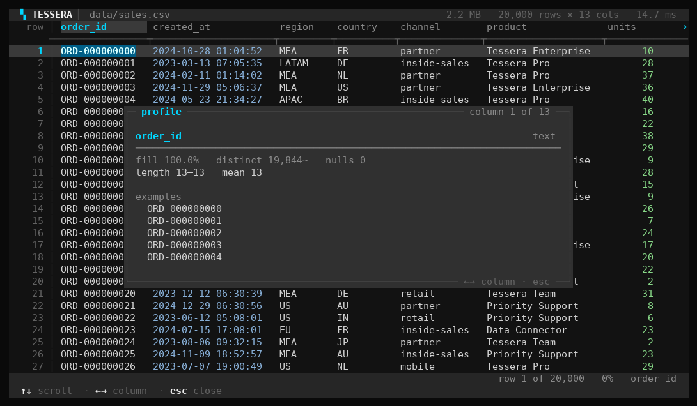

<div align="center">

# Tessera

**Open a 10 GB CSV in under a second. On your own machine. With no account, no upload, and no cloud bill.**

A single, dependency-free executable that explores multi-gigabyte CSV, TSV and JSONL files —
a keyboard-driven terminal explorer for humans, and a scriptable SQL CLI for pipelines.

`C++20` · `zero dependencies` · `offline by design` · `~1 MB executable` · `~190 MB RAM for a 10-million-row file`

[Why this exists](#why-this-exists) · [Performance](#performance-measured-not-marketed) · [Install](#install) · [Tour](#the-sixty-second-tour) · [Design](#how-it-was-built-and-why) · [Docs](docs/) · [Build](#building-from-source)

</div>

---



<div align="center"><sub>The explorer on a 20,000-row export. 1.1 GB files look the same — the grid never waits for the file.</sub></div>

---

## Why this exists

Every analyst, data engineer, auditor and support engineer has the same bad Tuesday: someone sends
a 3 GB CSV, and the tools they have are the wrong shape for it.

**The spreadsheet is the wrong shape.** Excel's own specification caps a worksheet at
1,048,576 rows by 16,384 columns. Microsoft's guidance for files beyond it is explicit that opening
one will not load everything — *"If you save this workbook, you'll lose data that wasn't loaded."*
([Excel specifications](https://support.microsoft.com/en-us/excel/excel-specifications-and-limits),
[too large for the grid](https://support.microsoft.com/en-us/excel/what-to-do-if-a-data-set-is-too-large-for-the-excel-grid))
Google Sheets caps a spreadsheet at 20 million cells
([Google Drive Help](https://support.google.com/drive/answer/37603)) — roughly 15k rows of a 13-column
file. The most common data tools in the world are structurally incapable of holding the files
people actually receive.

**The cloud answer is a privacy answer.** The products that *do* handle large CSVs are SaaS.
Row Zero's published plans are $12–20 *per user* per month, and its privacy policy states
*"We retain data on your behalf, such as workbooks"* ([pricing](https://rowzero.com/pricing),
[privacy](https://rowzero.com/privacy-policy)). Gigasheet stores *"Original uploaded files"* and
*"Parsed uploaded files"* in its AWS data centres ([security](https://www.gigasheet.com/security)).
That is a fine trade for a marketing team and a non-starter for patient records, payroll, security
logs, legal discovery, or anything under an NDA. Most of these files are never supposed to leave
the laptop they arrived on.

**The local answer is a scripting answer.** `pandas.read_csv` is for in-memory analytics by design
([scaling guide](https://pandas.pydata.org/docs/user_guide/scale.html)); on the 1.09 GiB file in our
benchmark it takes **34.8 s and 5.4 GB of RAM** just to become a DataFrame — measured below. DuckDB
reads CSVs on disk beautifully, but its documented route to a CSV is
`SELECT * FROM 'flights.csv';` ([docs](https://duckdb.org/docs/2.0/data/csv/overview.html)): you get
a database, which means you need to know SQL before you can *look* at the file. csvkit and VisiData
are Python applications ([csvkit](https://github.com/wireservice/csvkit/blob/master/pyproject.toml),
[VisiData](https://github.com/saulpw/visidata)), which means a Python install, a virtualenv, and a
dependency tree before the first glance.

So the gap is specific and real:

| | Handles 1 GB+ | Nothing leaves the machine | No install/runtime | Zero learning curve | Free & open |
|---|:--:|:--:|:--:|:--:|:--:|
| Excel / Google Sheets | ✗ | ✗ | ✓ | ✓ | ✗ |
| Gigasheet / Row Zero / Tad | ✓ | ✗ | ✓ | ✓ | ✗ |
| pandas / R scripts | ✓ | ✓ | ✗ | ✗ | ✓ |
| DuckDB CLI | ✓ | ✓ | ✓ | ✗ (SQL first) | ✓ |
| csvkit / VisiData | ✓ | ✓ | ✗ (Python) | ✓ | ✓ |
| **Tessera** | ✓ | ✓ | ✓ | ✓ | ✓ |

**Tessera is the missing cell in that table.** One file, no installer, no runtime, no network
permission needed. Double-click it, or drop a file onto it. It opens a 1 GB file in about a second
because it never loads the file — it memory-maps it and builds an 8-byte-per-row index — and then it
gives you both halves of what people actually want: a keyboard-driven grid for *looking*, and a real
SQL subset for *asking*.

The name is the idea. A **tessera** is a single small tile in a mosaic: no tile holds the picture,
but the pattern is only visible when they are laid side by side. Tessera never holds your file. It
holds the map of it.

### What we deliberately did *not* build

Ambition is cheap; restraint is the hard part. Tessera is not a database, not a notebook, not a
visualisation tool, and not a data-cleaning studio.

* **No joins.** One file is the entire mental model. `JOIN` means you should reach for DuckDB or a warehouse.
* **No writes to your data.** Tessera opens files read-only. Your input file is never modified — a claim the test suite checks.
* **No cloud, no telemetry, no account, no license key.** The binary makes no network calls at all. There is nothing to sign into.
* **No SQL dialect of convenience.** The query language is a small, frozen subset; people will script against it, so it must not grow dialects.
* **No Electron, no bundled runtime, no plugins.** The whole program is C++20 and the standard library.

---

## Performance, measured not marketed

All numbers below are from a real run on an 8 vCPU Linux container with `g++ 13.3.0 -O2`, warm page
cache, single run, release build. The corpus is generated deterministically by
[`scripts/gen_data.py`](scripts/gen_data.py) and is deliberately awkward — quoted commas, doubled
quotes, embedded newlines, ragged rows, empty cells — because that is what real exports look like.

| Corpus | Rows | Size | Columns |
|---|---:|---:|---:|
| `orders10m.csv` | 10,000,000 | 1,171,499,154 B (1.09 GiB) | 13 |
| `events4m.jsonl` | 4,000,000 | 940,375,307 B (897 MiB) | 9 (union of keys) |
| `orders2m.tsv` | 2,000,000 | 234,302,320 B (223 MiB) | 13 |

### Tessera

| Operation | Time | Throughput / detail |
|---|---:|---|
| Open + index `orders10m.csv` (8 threads) | **0.91 s** | 1.29 GB/s · 11.0 M rows/s · 76 MB index |
| `info` — open, detect dialect, infer types | **1.08 s** | 0.97 s warm; 26 ms for the 2.2 MB file |
| Re-open with `.tessera.idx` sidecar | **0.17 s** | 12.4 MB cache written beside the file |
| `head -n 5` (sidecar present) | **0.16 s** | constant time regardless of file size |
| Full scan + checksum | **0.073 s** | 14.89 GB/s · 136.5 M rows/s |
| `WHERE units > 36` (999,814 matches) | **0.79 s** | 12.7 M rows/s |
| `ORDER BY created_at` over 1,000,000 rows | **1.30 s** | |
| `SELECT count(*)` over 10,000,000 rows | **1.39 s** | includes the 0.91 s open |
| `GROUP BY region` + `sum` + `ORDER BY` over 10M rows | **4.96 s** | 5 aggregate groups |
| Export 999,814 matching rows to CSV | **4.44 s** | |
| `info` on `events4m.jsonl` (897 MiB) | **6.79 s** | JSONL is ~7× costlier to index than CSV |
| `stats` — full profile of `events4m.jsonl` | **12.03 s** | quantiles, histogram, top values |
| `info` on `orders2m.tsv` (223 MiB) | **0.54 s** | |

Reproduce any of it with `tessera bench <file>`, or read
[`docs/BENCHMARKS.md`](docs/BENCHMARKS.md) for the full methodology and the sampling harness.

### The same file, the same machine, the honest comparison

| Approach | Time to be ready | Peak RSS | Notes |
|---|---:|---:|---|
| `python csv.reader` → list of lists | 56.96 s | **8.02 GB** | stdlib only |
| `pandas.read_csv` 3.0.5 (`low_memory=False`) | 34.84 s | **5.36 GB** | then `groupby` +0.89 s |
| **Tessera** open + profile (`info`) | **1.08 s** | **184 MB** | 32× faster, 29× smaller |
| **Tessera** open + `GROUP BY region` + `sum` | **4.96 s** | **184 MB** | pandas answer took 35.74 s |

Two things worth noting. First, **memory does not scale with file size.** The index is 8 bytes per
row, so ten million rows costs 76 MB — while pandas needs 5.4 GB for the decoded copy. Second, the
numbers agree: Tessera and pandas return the same five regional revenue sums to seven significant
digits on those ten million rows, which is the cross-check that keeps a fast engine honest.

### Memory, explained precisely

Peak RSS during a full scan looks large (1.1 GB for a 1.1 GB file) because the memory-mapped file
pages count as resident *file-backed* memory — that is the operating system's page cache, and it is
reclaimable under pressure. The number that matters is anonymous memory, which is the program's own
allocation:

| Operation | Peak anonymous | Peak file-backed (reclaimable) |
|---|---:|---:|
| `info` on `orders10m.csv` (1.09 GiB) | 184 MB | 1,121 MB |
| `info` on `events4m.jsonl` (897 MiB) | 556 MB | 899 MB |
| `info` on `orders2m.tsv` (223 MiB) | 34 MB | 227 MB |

Tessera opens a 1.09 GiB file with under 200 MB of its own memory, and a 223 MiB file with 34 MB.
That is the whole trick, stated honestly.

---

## Install

**Windows** — download `tessera.exe`, put it anywhere, run it. It is a
statically linked `PE32+` executable whose only imports are the Windows system libraries
(`KERNEL32`, `SHELL32`, and the Universal C Runtime that ships with Windows 10 and 11). There is no
installer, no Visual C++ redistributable, no DLL beside it, and no uninstaller because nothing is
installed.

```powershell
tessera.exe orders.csv          # open the explorer
tessera.exe info orders.csv     # one-shot summary, exits
```

**Package managers** — winget, Scoop and a Homebrew tap are prepared for, not live:
`winget install Tessera.Tessera`, `scoop install tessera` and
`brew install rkohnmn/tessera/tessera` will each resolve once their manifest lands in the
registry. The manifests are generated from the published release archives (never hand-written, and
never committed with a hash that belongs to a different build) and attached to each release; see
[`packaging/README.md`](packaging/README.md) for the process and
[`docs/INSTALL.md`](docs/INSTALL.md#package-manager-manifests) for the state of each channel.

**Linux / macOS** — use the prebuilt binary or build in one command:

```sh
make -j"$(nproc)"        # -> build/tessera
```

[`docs/INSTALL.md`](docs/INSTALL.md) covers every route in full: checksum verification, the
SmartScreen and Gatekeeper warnings on an unsigned binary, `PATH` setup, and troubleshooting.

**Terminal requirements.** Tessera draws with the alternate screen buffer and 24-bit colour, so any
modern terminal works: Windows Terminal, iTerm2, GNOME Terminal, Alacritty, Kitty, WezTerm, foot.
Piped output is automatically plain — `tessera query ... > out.csv` emits clean CSV with no escape
codes, which is why the same binary is both an interactive app and a pipeline tool.

---

## The sixty-second tour

### Point it at a file

```console
$ tessera info orders10m.csv
◆ orders10m.csv
  format        delimited · comma separated · header row
  encoding      utf-8
  size          1.1 GB
  rows          10,000,000
  columns       13
  row width     117 B average · 148 B widest sampled
  nulls         610 in sampled cells
  index         built at open · 2.8 s · 76 MB resident
  open time     2825 ms
  threads       8

  detection
    · delimiter: , (13 fields, 100% of sampled records agree)
    · first record treated as a header (names are text, data below is typed)

  columns
    1. order_id                      text      100% typed
    2. created_at                    timestamp 100% typed
    ...
    7. units                         integer   100% typed
    9. revenue                       float     100% typed
```

That is a 1.1 GB file, understood — encoding sniffed, delimiter confirmed by agreement rate, header
detected, and every column typed — without ever reading it into memory.

Those 2.8 seconds are a genuine **first** open on a cold page cache. Once the file is in the OS
cache it drops to about one second, and once the optional sidecar index exists, to 0.17 s — see the
benchmark table below for how each of those was measured.

### Ask it a question

```console
$ tessera query orders10m.csv \
    "SELECT region, count(*) orders, sum(revenue) revenue
     FROM t GROUP BY region ORDER BY revenue DESC"
region,orders,revenue
LATAM,2001896,21463054623
US,1999512,21429415811.2
EU,1998901,21414050958.2
MEA,1999129,21406652189.7
APAC,2000562,21394233345.4
```

No dot-comma dialect, no `t` prefix, no `--format=csv` flag. `t` is the file. Output is CSV when
piped and a colour table when attached to a terminal.

### Profile a column

`stats` answers the question people actually have — *can I trust this column?*

```
◆ revenue  float
  fill 100.0%  ·  distinct 1,026  ·  nulls 10
  min 31.2   p25 1092   median 2844   p75 7984   max 96000
  mean 10600.169   sd 19249.729   p99 86400
  ███▃▃▃▂▂▂▁▁▁▁▁▁▁▁▁▁▁▁▁▁▁▁▁▁▁▁▁▁▁▁▁▁▁▁▁▁▁▁▁▁▁▁▁▁▁▁▁▁▁▁▁▁▁▁▁▁▁▁▁▁▁▁▁▁▁▁▁▁▁

◆ status  text
  fill 99.8%  ·  distinct 4  ·  nulls 34
  length 4–8   mean 5.5
  top paid (9,973)  ·  refunded (3,391)  ·  failed (3,384)  ·  pending (3,218)
```

Distinct counts come from a 2¹⁴-register HyperLogLog (~0.8% error) so profiling a 40 GB file costs
the same bounded memory as profiling a small one.

### Explore it with the keyboard

Run `tessera orders10m.csv` and you get the grid from the screenshot at the top: column widths
sized to content, a type row, a filter bar, an inline SQL command line, per-column profiles, a
detail view for the row under the cursor, and a `:` command line for real queries — all of it live
over a file far larger than memory.

| Key | Action |
|---|---|
| `j` `k` / `↓` `↑` | move down / up one row |
| `h` `l` / `←` `→` | scroll columns |
| `PageUp` `PageDown` | page through rows |
| `g` `G` / `Home` `End` | jump to first / last row |
| `/` | **search** — case-insensitive, every column; the grid collapses to the matches |
| `f` | **filter** — a real expression: `revenue > 1000 AND status = 'failed'` |
| `s` | **sort menu** — `↑`/`↓` pick a column, `1`–`9` sorts by that column at once, `a`/`d` ascending/descending, `s` flips direction, `c` clears, `↵` applies |
| `p` | **profile** the current column; inside the profile `←`/`→` steps across columns |
| `↵` | **inspect** the record under the cursor, one field per line |
| `:` | **command** — run any SQL statement and replace the grid with the result |
| `e` | **export** the current (filtered, sorted) view to a file |
| `y` | copy the cell under the cursor |
| `r` | reload the file from disk — after a writer appends, without restarting |
| `t` | toggle the type row |
| `?` | full help |
| `q` / `Esc` | quit / clear the active filter |

Every long operation — indexing, filtering, sorting, profiling, exporting — runs on a worker thread
with a live progress bar and is cancellable with `Esc`. The UI never blocks, and the grid stays
responsive while a 10-million-row sort is in flight.




---

## How it was built, and why

Roughly 11,000 lines of C++20 across `src/` and `tests/`, no third-party dependencies, no build-time
code generation except the compiler. The full reasoning lives in [`docs/DESIGN.md`](docs/DESIGN.md);
the short version of the decisions that shaped the program:

**1. Memory-map the file; never read it.** `mmap` on POSIX, `CreateFileMapping`/`MapViewOfFile` on
Windows, with a portable `Source` abstraction on top. The file becomes an address range; the kernel
pages it in as needed. This is what makes "open a 40 GB file" a sub-second operation instead of an
out-of-memory error, and it is why Tessera's memory ceiling is set by the *index*, not the data.

**2. Index once, in parallel, with a quote-parity trick.** The in-memory index is one 8-byte offset
per record — 80 MB at ten million rows, and the only per-file cost. Building it in parallel across
8 threads is subtle: CSV quoting is a state machine, so a thread cannot know whether its chunk
*starts* inside a quoted field. A naive implementation serialises, or worse, produces a corrupt
index. Tessera's answer is to exploit a property of well-formed CSV: every record contains an even
number of quote characters, so the running **quote parity** of the prefix up to any byte offset
gives that offset's exact state. Pass 1 counts quotes per chunk (SIMD-accelerated), pass 2 scans
each chunk knowing its starting state. Two cheap passes, no locks, no coordination, and correct in
the presence of embedded newlines and doubled quotes — which the test suite specifically checks.
If the total quote count is odd the file is malformed and the engine falls back to a repairing
sequential scan that abandons a runaway quote after 1 MiB rather than swallowing the rest of the file.

**3. Use SWAR for the hot scans.** Searching for `\n` (and `"`) is the single hottest loop in the
program. [`src/core/simd.hpp`](src/core/simd.hpp) implements word-at-a-time byte search — the classic
`(v - 0x0101…) & ~v & 0x8080…` trick over 64-bit words — with no intrinsics, no `#ifdef` per
architecture, and no runtime dispatch. It compiles everywhere, vectorises well, and delivers the
14.89 GB/s scan above. We chose SWAR over AVX2 intrinsics deliberately: the achievable gain was
~1.5×, and the cost was five architecture-specific code paths in the most correctness-critical
function in the program. Worth revisiting; not worth the risk on day one.

**4. Build the TUI on a diffing cell renderer, not a widget toolkit.** A grid that redraws 5,000
cells per frame flickers and tears over SSH. [`src/tui/screen.hpp`](src/tui/screen.hpp) keeps the
previous frame's characters and attributes and emits escape sequences only for cells that changed,
batched by attribute run. Cursor movement is minimised, so scrolling a wide grid stays smooth on a
slow link. No ncurses, no termbox — about 400 lines we fully control on both POSIX `termios` and the
Win32 console API.

**5. Unicode correctness from the start, not bolted on.** Column widths, truncation and the grid all
measure **display columns**, so CJK and emoji occupy the two cells they actually occupy, combining
marks take none, and control bytes from hostile input are neutralised before they reach the
terminal. `truncate_width`, `utf8_measurement` and `sanitize` are unit-tested
([`tests/test_text.cpp`](tests/test_text.cpp)) precisely because this is where terminal UIs usually
break.

**6. Make the numbers reproducible.** `tessera bench` ships inside the binary and times open, scan,
filter and sort on *the user's own file and their own hardware*, so nobody has to take a README's
word for it. The benchmark corpora are generated by a seeded script, and the baseline comparisons
are in the repo as runnable harnesses.

**7. Treat the query language as frozen API.** [`src/query/parser.hpp`](src/query/parser.hpp) states
the rule in its header comment: a deliberately boring SQL subset, no joins, no subqueries. People
will script against it in CI. A language that quietly gains convenient dialects is a language you
cannot upgrade against.

**8. Errors are part of the interface.** A mistyped column name suggests the real one; a bad
delimiter override reports what was detected and why; CSV problems are reported with their record
number. Getting a file "wrong" should take ten seconds to fix, not ten minutes of guessing.

**9. Ship the `.exe` as the primary artefact.** The whole product is one file you can email. Reaching
that from Linux is [`scripts/build_windows.sh`](scripts/build_windows.sh): Zig's bundled clang and
MinGW-w64 runtime cross-compile a statically linked `PE32+` binary, so there is no Windows machine,
no MSVC licence and no dependency on a CI runner's toolchain in the loop. On Windows itself, CMake
with MSVC or MinGW is the supported path and produces the same single file with a static CRT.

---

## Command reference

```
tessera <file>                       open the interactive explorer
tessera <command> <file> [options]
```

| Command | Purpose |
|---|---|
| `info <file>` | shape, encoding, detected dialect, inferred column types |
| `head <file> [-n N]` | first N rows (default 20) |
| `tail <file> [-n N]` | last N rows |
| `stats <file> [-c a,b] [--sample]` | per-column profiles: fill rate, quantiles, histogram, top values |
| `query <file> "SELECT …"` | run a query; table on a TTY, CSV when piped |
| `export <file> [-q SQL] [-o out] [-f fmt]` | stream rows to CSV, TSV, JSONL or a printed table |
| `index <file>` | build the `.tessera.idx` sidecar for instant re-opens |
| `bench <file>` | time open, scan, filter and sort on this machine |
| `help` / `version` | usage / version |

| Option | Meaning |
|---|---|
| `-n, --limit <n>` | row limit for `head` / `query` |
| `-c, --columns <a,b>` | restrict to these columns |
| `-q, --query <sql>` | statement for `query` / `export` |
| `-o, --output <path>` | export destination (`-` for stdout) |
| `-f, --format <fmt>` | `csv` \| `tsv` \| `jsonl` \| `table` |
| `-d, --delimiter <c>` | override delimiter detection |
| `--header` / `--no-header` | force the header interpretation |
| `--threads <n>` | indexer worker count (default: hardware concurrency, capped at 16) |
| `--cache-index` | write a `.tessera.idx` during this run |
| `--no-index` | ignore an existing sidecar |
| `--sample` | profile a bounded sample instead of every row |
| `--no-color` | plain output |

## The query language

One file, one table called `t`. The full grammar and function list are in
[`docs/QUERY.md`](docs/QUERY.md). It supports:

* `SELECT` with `*`, expressions, `AS` aliases and `DISTINCT`
* `WHERE` with `= <> < <= > >=`, `AND` / `OR` / `NOT`, `LIKE` / `NOT LIKE`, `IN (…)`, `BETWEEN`, `IS NULL`
* `GROUP BY` + `count` · `count_distinct` · `sum` · `avg` · `min` · `max`, with a bare `HAVING`-free `ORDER BY` on aggregates
* `ORDER BY` one or more keys, `ASC` / `DESC`, with `LIMIT` / `OFFSET`
* Scalars: `lower` `upper` `trim` `ltrim` `rtrim` `len` `substr` `replace` `concat` `abs` `round` `floor` `ceil`
  `int` `float` `text` `coalesce` `ifnull` `year` `month` `day` `date` `startswith` `endswith` `contains`

```console
tessera query huge.csv "SELECT * WHERE status = 'failed' AND units > 10" -f jsonl
tessera export huge.csv -q "SELECT customer_id, sum(revenue) FROM t GROUP BY customer_id" -o per_customer.csv
tessera query events.jsonl "SELECT year(created_at) y, count(*) FROM t GROUP BY y ORDER BY y"
```

---

## Building from source

**Requirements:** a C++20 compiler (GCC 11+, Clang 14+, MSVC 19.30+) and CMake 3.20+, or just `make`
on Linux/macOS. There are no third-party libraries to fetch — the build is self-contained on purpose.

```sh
# Canonical build (all platforms)
cmake -B build-cmake -DCMAKE_BUILD_TYPE=Release
cmake --build build-cmake -j
ctest --test-dir build-cmake --output-on-failure

# Linux/macOS one-liner
make -j"$(nproc)" && make test

# Windows cross-compile from Linux/macOS (Zig) -> dist/tessera.exe
scripts/build_windows.sh
```

CMake options:

| Option | Default | Effect |
|---|---|---|
| `TESSERA_BUILD_TESTS` | `ON` | build the unit suite |
| `TESSERA_LTO` | `ON` | interprocedural optimisation when supported |
| `TESSERA_STRICT` | `OFF` | promote warnings to errors (used by CI) |

The build is warning-clean under both GCC's and Clang's full warning sets with `-Werror` enabled,
on Linux and for the Windows target.

## Testing

113 unit tests cover the parts where a bug is silent rather than loud: CSV quoting and escaping
(including doubled quotes, embedded newlines and ragged rows), BOM and UTF-16 transcoding, delimiter
detection, type inference and null handling, byte-exact round-tripping of row text, the index and its
sidecar, the SQL lexer/parser/executor including aggregates and error suggestions, HyperLogLog
distinct estimation, timestamp parsing, UTF-8 display-width measurement, control-byte sanitisation,
and CSV/JSONL writing. Thirteen of them cover the argument layer — exit code and message for every
argument the program can reject — after a release-blocking bug turned up there rather than in the
engine; see [docs/DESIGN.md §12](docs/DESIGN.md) for how that happened.

```sh
make test        # or: ctest --test-dir build-cmake --output-on-failure
```

Correctness is also checked against the wider world: on the 10-million-row benchmark file, Tessera's
per-region `sum(revenue)` matches `pandas` to seven significant digits.

### The checks that are not unit tests

Four other harnesses run over the same code, because a parser that reads hostile files all day needs
more than examples that were written to pass.

```sh
scripts/verify_sanitizers.sh              # ASan + UBSan build, full suite, then fuzz it
python3 tests/fuzz_tessera.py --cases 300 # differential against Python's csv, plus mutation
WINE=wine scripts/verify_windows_runtime.sh   # run the .exe and diff it against the Linux build
```

* **Sanitizers.** The whole suite and a fuzz sweep run under AddressSanitizer and
  UndefinedBehaviorSanitizer with leak detection on, on both GCC and Clang
  (`scripts/verify_sanitizers.sh`, run by CI).
* **Fuzzing.** A differential fuzzer generates random but well-formed delimited files and requires
  byte-identical results with Python's `csv` module after Tessera has guessed the dialect by itself;
  a mutation fuzzer corrupts valid files (truncation, byte flips, duplicated quotes, splices, injected
  NULs) and requires that malformed input is *reported*, never crashing, hanging, or producing an
  impossible index. Failing inputs are kept in `artifacts/fuzz-crashes/` with the command to replay
  them.
* **Adversarial cache tests.** The `.tessera.idx` sidecar is treated as untrusted input: truncated,
  bit-flipped, stale, and forged-with-a-valid-checksum files are all required to be ignored, and a
  crafted row count must be rejected without allocating for it.
* **The Windows executable is executed, not just compiled.** `scripts/verify_windows_runtime.sh` runs
  `dist/tessera.exe` under Wine and compares 87 checks against the Linux binary built from the same
  sources: every CLI verb, exit codes and error text on six runtime failure paths *and* seven
  argument-parsing paths, non-ASCII and emoji paths, sidecar write/reuse/recovery, UTF-8 bytes
  surviving the console layer, and a 113 MB filtered export plus a full group-by over the 1.1 GB
  10-million-row corpus, both byte-identical across the two builds. Running it, rather than reasoning
  about it, is what found three real bugs: narrow-`fopen` failures on non-ASCII Windows paths; an
  incomplete exception table from linking with LTO, which made `tessera query ... "SELECT nope FROM t"`
  print `libc++abi: terminating due to uncaught exception` and exit 3 instead of printing one line and
  exiting 1; and argument parsing sitting outside the `try` in `cli::run`, which aborted the process on
  *every* platform — exit 134 on Linux, 3 on Windows — for something as ordinary as a mistyped flag,
  instead of printing `error unknown option '--bogusflag'`. The third bug was in the code the whole
  time; what exposed it was finally diffing the argument-error paths too, instead of only the failures
  raised from inside the engine.

Continuous integration builds with GCC and Clang, runs the suite under sanitizers on both, builds the
Windows executable twice (MSVC on Windows, Zig cross-compile), runs the error-path and non-ASCII
checks against the native Windows binary, fuzzes the parser, and fails on any warning
([`.github/workflows/ci.yml`](.github/workflows/ci.yml)).

## Reproducing the benchmarks

```sh
python3 scripts/gen_data.py --rows 10000000 --out bench/orders10m.csv
python3 scripts/gen_data.py --rows 4000000 --format jsonl --out bench/events4m.jsonl
python3 scripts/gen_data.py --rows 2000000 --format tsv --out bench/orders2m.tsv

tessera bench bench/orders10m.csv          # timing, from the tool itself
python3 bench/measure.py                   # wall time + peak RSS per command
python3 bench/measure_anon.sh              # anonymous vs mapped memory
python3 bench/baseline_pandas.py bench/orders10m.csv   # the comparison
```

## Limitations, stated plainly

* **One file at a time.** No joins, no unions, no cross-file queries — by design.
* **Read-only.** Tessera never writes to your data files. `export` writes a new file; nothing else does.
* **The index lives in RAM for the session.** Re-opening a huge file costs another index build unless you keep the sidecar (`tessera index <file>`, or `--cache-index`).
* **JSONL is indexed per record, not per key.** Nested objects are flattened one level for column detection; deeply nested JSON is best handled by a JSON-aware tool.
* **Type inference samples.** Detection reads a sample of records, not all of them; a column whose type changes 900 MB in can be reported from its head. `stats` profiles every row by default (or a bounded sample with `--sample`) so you can confirm.
* **`ORDER BY` sorts in memory.** Sorting a billion rows is a job for a database; Tessera is built for looking and for answers that fit.
* **Windows binary verification is runtime-verified under Wine, not on a physical Windows host.** `dist/tessera.exe` is cross-compiled, statically linked, validated as a `PE32+` image importing only Windows system libraries, and then *executed*: 87 checks under Wine 10.0 compare it against the Linux binary — every CLI verb, six runtime failure paths plus seven argument-parsing paths with their exit codes and messages, non-ASCII and emoji file paths, the sidecar cache, UTF-8 output bytes, and a 113 MB filtered export plus a group-by over the 10-million-row (1.1 GB) file, all byte-identical between the two builds. Wine is a real Win32 loader, so it exercises the console API calls, `CreateFileMapping` and the exception machinery for real; native MSVC CI additionally runs the same binary on a real Windows runner. What is still not covered here is a physical Windows 10/11 machine with a real console host and a real filesystem — Windows Terminal's ANSI handling, a network share, and antivirus interference are the remaining unknowns, and running `tessera info big.csv` on your machine is the two-minute check that closes them.
* **No binary is signed.** Windows SmartScreen will warn on first run of an unsigned download. This is expected until code-signing certificates are set up.

## Roadmap

Deliberately small, in rough priority order: a signed Windows release, memory-mapped Parquet for
columnar files, `ORDER BY` spilling to disk so sorting is bounded too, multiple simultaneous files in
side-by-side panes, and a `--script` mode that runs a named pane layout from a small config file.
Nothing on this list is a promise; the list exists so that "not yet" is a decision instead of an
oversight.

## Project layout

```
src/common/     error types, cancel/progress tokens, formatters, text utilities
src/core/       source (mmap), dialect detection, dataset, parallel indexer, sidecar, profiling
src/query/      SQL subset: lexer, parser, expression evaluator, executor
src/io/         output formats (CSV/TSV/JSONL/table), profile and result rendering
src/cli/        argument parsing, command dispatch, one-shot output modes
src/tui/        terminal layer (POSIX + Win32), diffing screen renderer, app state, views
tests/          dependency-free test harness, the unit suite, and the fuzzers
scripts/        data generator, cross-compile, sanitizer/Windows verifiers, package manifests
docs/           architecture, query reference, design decisions, benchmarks, comparison, install
packaging/      how the winget, Scoop and Homebrew manifests are produced and submitted
bench/          reproducible benchmark and baseline harnesses
```

## Documentation

| Document | Contents |
|---|---|
| [`docs/ARCHITECTURE.md`](docs/ARCHITECTURE.md) | module by module, the data flow, threading model, and the index format |
| [`docs/QUERY.md`](docs/QUERY.md) | the complete query grammar, operators and function reference |
| [`docs/DESIGN.md`](docs/DESIGN.md) | every significant design decision, the alternatives rejected, and why |
| [`docs/BENCHMARKS.md`](docs/BENCHMARKS.md) | corpus definition, methodology, per-operation numbers, honest caveats |
| [`docs/COMPARISON.md`](docs/COMPARISON.md) | the 2026 landscape of large-CSV tools, with sources |
| [`docs/INSTALL.md`](docs/INSTALL.md) | every install route, checksum verification, package-manager state, troubleshooting |
| [`CONTRIBUTING.md`](CONTRIBUTING.md) | build, test, style and review expectations |
| [`CHANGELOG.md`](CHANGELOG.md) | release history |

## License

MIT — see [`LICENSE`](LICENSE). Use it at work, ship it internally, fork it.

<div align="center"><sub>Built to be held in one hand: one file, no network, no account, no expiry.</sub></div>
